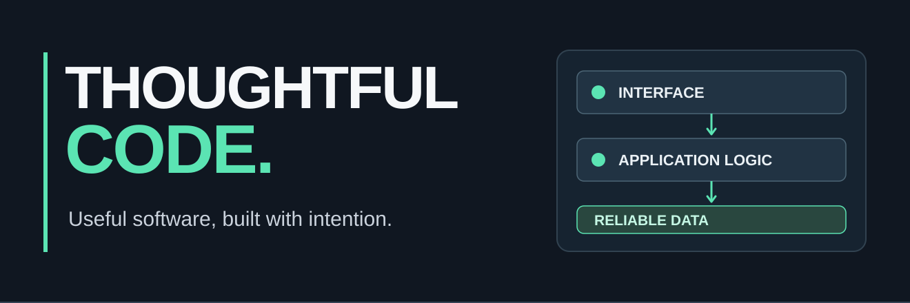

  

<h1 align="center">Hey, I'm Berke.</h1>

  <strong>Full-stack developer</strong> · Web, mobile & systems engineering 
  I build software that makes everyday work simpler, clearer, and more reliable.

  <a href="https://github.com/syberke/BERKE_PORTOFOLIO"><strong>Explore my portfolio ↗</strong></a>
  &nbsp;&nbsp;·&nbsp;&nbsp;
  <a href="https://github.com/syberke?tab=repositories">Browse repositories ↗</a>

---

### The kind of work I do

I like projects where the interface, the API, and the data model have to work together. Most of my work sits between **full-stack application development**, **role-based systems**, and **practical tools** for education and operations.

Right now, I'm exploring better approaches to **secure APIs, event-driven workflows, real-time applications, and developer experience**. I care about understandable code as much as the finished product.

### Selected work

| Project | What it solves | Stack / focus |
| :--- | :--- | :--- |
| **[IQRA](https://github.com/syberke/iqra)** | School monitoring and Qur'an memorization tracking for different user roles. | React · Laravel · MySQL |
| **[Hotel Management](https://github.com/syberke/hotel-management)** | Hotel operations, including rooms, guests, reservations, and payment workflows. | Next.js · Prisma · PostgreSQL |
| **[Bansos](https://github.com/syberke/bansos)** | Social assistance data management and distribution records. | Laravel · MySQL |
| **[Berke Portfolio](https://github.com/syberke/BERKE_PORTOFOLIO)** | A project-led portfolio with responsive layouts and accessible interaction patterns. | Next.js · React |

These are selected public repositories. Other work is in private or ongoing projects and is intentionally not linked here.

### Tools I work with

| Area | Technologies |
| :--- | :--- |
| **Frontend** | TypeScript, JavaScript, React, Next.js, Vue, Tailwind CSS |
| **Backend & APIs** | C#, ASP.NET Core, PHP, Laravel, Node.js, REST APIs |
| **Data** | PostgreSQL, MySQL, Prisma, Entity Framework Core |
| **Mobile** | React Native, Flutter |
| **Workflow** | Git, GitHub Actions, Docker, Postman |

I choose tools based on the problem rather than trying to fit every project into one stack.

### What I'm building toward

- **Better systems:** clear API contracts, authorization boundaries, predictable data flows.
- **Better experiences:** useful interfaces that are straightforward to navigate.
- **Better engineering habits:** small changes, meaningful tests, and deployment-aware decisions.

---

  <strong>Have an interesting problem to solve?</strong> 
  <a href="https://github.com/syberke/BERKE_PORTOFOLIO">Take a look at my work</a> · <a href="https://github.com/syberke">Connect on GitHub</a>

